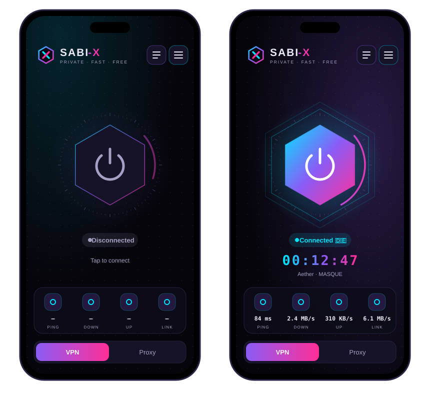
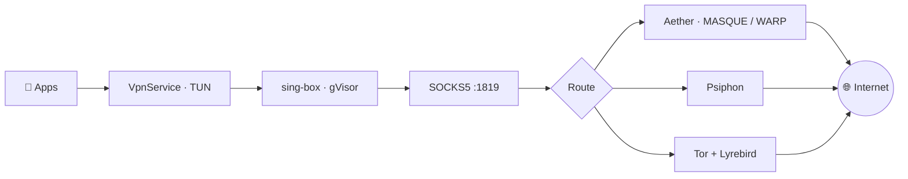

 

**Private · Fast · Free**

[English](#-english) &nbsp;•&nbsp; [فارسی](#-فارسی)

---

## 🇬🇧 English

**SABI-X** is a sleek, lightweight Android tunnel that keeps you connected on heavily filtered networks.
It combines **Aether** (MASQUE / WARP), **Psiphon** and **Tor** behind one tap, with **sing-box** as the TUN engine.
Neon-dark UI built with Jetpack Compose. English and Persian, full RTL.

### 📸 Preview

 Idle · Connected

### ⬇️ Download

| APK | Best for |
| :-- | :-- |
| [`SABI-X-arm64-v8a.apk`](https://github.com/sabi-karami/SABI-X/releases/latest) | 📱 Most modern phones (64-bit) |
| [`SABI-X-armeabi-v7a.apk`](https://github.com/sabi-karami/SABI-X/releases/latest) | 📟 Older phones (32-bit) |
| [`SABI-X-universal.apk`](https://github.com/sabi-karami/SABI-X/releases/latest) | 🤷 Not sure? Use this one |

### ✨ Features

| | |
| :-- | :-- |
| ⚡ **One-tap connect** | Hexagonal power core with live status, exit-country flag, ping and speed |
| 🧭 **Route switcher** | Aether · Aether → Psiphon · Aether → Tor · Psiphon · Tor · reverse routes |
| 🛰️ **Protocols** | MASQUE · WireGuard · WARP-in-MASQUE · WARP-in-WARP · MASQUE-in-MASQUE |
| 🔁 **Smart reconnect** | Recovers from core crashes, failed pings and Wi-Fi ↔ mobile switches |
| 🎯 **Split tunneling** | Include or exclude any app |
| 🧱 **Routing rules** | Block / direct lists (domains, IPs, CIDR, ports), custom DNS, upstream proxy |
| 📡 **Share over hotspot / USB** | Give your laptop SOCKS5 / HTTP access through the phone |
| ⏸️ **Pause & resume** | Turn the VPN off for banking apps while the core stays warm |
| 🛠️ **Deep tuning** | Scan level, obfuscation, MTU, TCP buffer, ping policy and more |
| 🔔 **Extras** | Quick Settings tile, start on boot, dark / light theme, dynamic color |

### 🧬 How it works

Ports: SOCKS5 `1819` · Tor `1820` · Psiphon `1821` · HTTP `1822` (optional). SOCKS5 and HTTP ports are configurable.

### 🏗️ Build from source

Everything is built by GitHub Actions ([`main.yml`](.github/workflows/main.yml)): Aether (Rust), Psiphon & Lyrebird (Go), hev-socks5-tunnel, sing-box `libbox`, then the APKs.

1. Fork this repository.
2. Add the secrets `KEYSTORE_BASE64`, `KEYSTORE_PASSWORD`, `KEY_ALIAS`, `KEY_PASSWORD` under **Settings → Secrets and variables → Actions**.
3. Push to `main` (APKs as artifacts) or push a `v*` tag (APKs attached to a release).

### 🙏 Credits

SABI-X is designed and maintained by **[Saheb Karami](https://github.com/sabi-karami)**.
It is a modified version of [8 VPN](https://github.com/Mrmmd2004/8vpn) by Mrmmd2004 (see [NOTICE](NOTICE.md)) and stands on these projects:

| Component | Role | License |
| :-- | :-- | :-- |
| [Aether](https://github.com/CluvexStudio/Aether) | Core engine for every route | AGPL-3.0 |
| [sing-box](https://github.com/SagerNet/sing-box) | Default TUN engine (gVisor) | GPL-3.0 + terms |
| [Psiphon](https://github.com/Psiphon-Labs/psiphon-tunnel-core) | Circumvention route | GPL-3.0 |
| [Tor](https://www.torproject.org) · [Lyrebird](https://gitlab.torproject.org/tpo/anti-censorship/pluggable-transports/lyrebird) | Onion routing + pluggable transports | BSD-3-Clause |
| [hev-socks5-tunnel](https://github.com/heiher/hev-socks5-tunnel) | Fallback TUN engine | MIT |

### ⚖️ License

[GNU AGPL-3.0](LICENSE). Sharing the proxy lets anyone on the same hotspot use it — use a strong hotspot password and turn sharing off when you are done.

---

## 🇮🇷 فارسی

**SABI-X** یک تونل سبک و شیک برای اندرویده که روی شبکه‌های با فیلترینگ سنگین هم وصلت نگه می‌داره.
**Aether** (MASQUE / WARP)، **Psiphon** و **Tor** رو با یک لمس در اختیارت می‌ذاره و **sing-box** موتور TUN اونه.
رابط کاربری نئونی و تیره با Jetpack Compose، فارسی و انگلیسی با پشتیبانی کامل راست‌به‌چپ.

### ⬇️ دانلود

| فایل | مناسب برای |
| :-- | :-- |
| [`SABI-X-arm64-v8a.apk`](https://github.com/sabi-karami/SABI-X/releases/latest) | 📱 اکثر گوشی‌های جدید (۶۴ بیتی) |
| [`SABI-X-armeabi-v7a.apk`](https://github.com/sabi-karami/SABI-X/releases/latest) | 📟 گوشی‌های قدیمی‌تر (۳۲ بیتی) |
| [`SABI-X-universal.apk`](https://github.com/sabi-karami/SABI-X/releases/latest) | 🤷 اگه مطمئن نیستی این رو بگیر |

### ✨ امکانات

- ⚡ **اتصال با یک لمس:** دکمه‌ی شش‌ضلعی با وضعیت زنده، پرچم کشور خروجی، پینگ و سرعت
- 🧭 **انتخاب مسیر:** Aether، Aether ← Psiphon، Aether ← Tor، Psiphon، Tor و مسیرهای معکوس
- 🛰️ **پروتکل‌ها:** MASQUE، WireGuard، WARP-in-MASQUE، WARP-in-WARP و MASQUE-in-MASQUE
- 🔁 **اتصال مجدد هوشمند:** بعد از قطعی هسته، خطای پینگ یا جابه‌جایی وای‌فای و دیتا
- 🎯 **تونل‌سازی انتخابی:** فقط برنامه‌های دلخواه یا همه به‌جز اون‌ها
- 🧱 **قوانین مسیریابی:** لیست بلاک و مستقیم، DNS دلخواه و پروکسی بالادستی
- 📡 **اشتراک با هات‌اسپات / USB:** لپ‌تاپ از SOCKS5 / HTTP گوشی استفاده کنه
- ⏸️ **توقف و ادامه:** VPN برای برنامه‌های بانکی خاموش بشه ولی هسته روشن بمونه
- 🛠️ **تنظیمات حرفه‌ای:** سطح اسکن، مبهم‌سازی، MTU، بافر TCP و …

### 🙏 سپاس

SABI-X توسط **[صاحب کرمی](https://github.com/sabi-karami)** طراحی و نگهداری می‌شه.
این برنامه نسخه‌ی تغییریافته‌ی [8 VPN](https://github.com/Mrmmd2004/8vpn) از Mrmmd2004 است (فایل [NOTICE](NOTICE.md)) و بر پایه‌ی Aether، sing-box، Psiphon، Tor، Lyrebird و hev-socks5-tunnel ساخته شده.

### ⚖️ مجوز

[GNU AGPL-3.0](LICENSE). با اشتراک‌گذاری پروکسی هر کسی روی همون هات‌اسپات می‌تونه ازش استفاده کنه؛ رمز هات‌اسپات رو قوی بذار و بعد از کار اشتراک رو خاموش کن.

---

 
Made with 💜 by <a href="https://github.com/sabi-karami">Saheb Karami</a>

